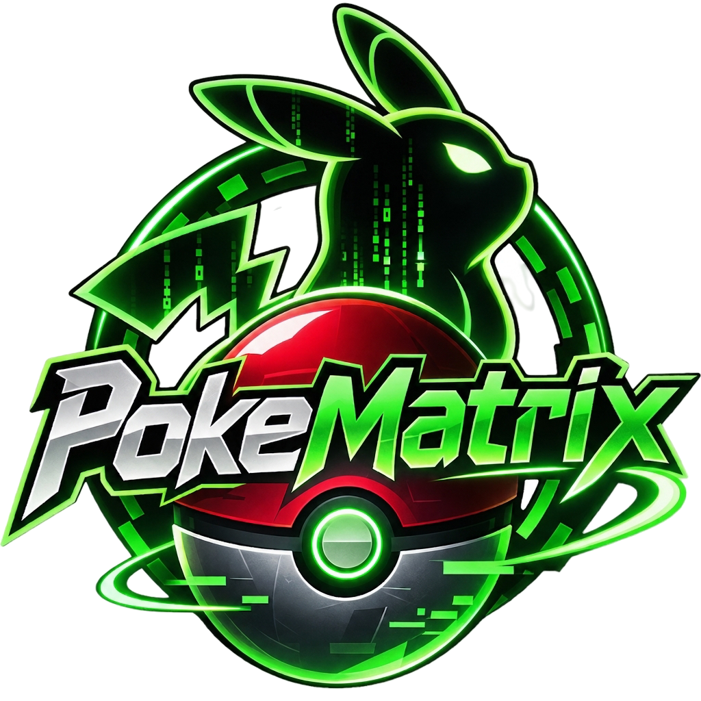

# PokeMatrix

  

  <strong>Gotta catch 'em all, on Matrix.</strong>
   
  A community-driven Pokémon collecting game for the Matrix ecosystem.

  
  
  
  

---

PokeMatrix is an open-source Pokémon collecting game for the [Matrix](https://matrix.org/) ecosystem.

Inspired by the original [Pokécord](https://github.com/PokeCord/PokeCord) and built upon the open-source codebase of [Pokétwo](https://github.com/poketwo/poketwo), PokeMatrix aims to bring the complete Pokémon collecting experience to Matrix communities.

Catch Pokémon as they appear in chat rooms, build your collection, complete your Pokédex, level up, evolve, trade, battle, and compete with other players.

> **Development Status:** Early development. PokeMatrix is not yet functional as a Matrix bot. The original Pokétwo codebase is currently being adapted for Matrix compatibility.

## Contributing

Contributions are welcome! Please open an issue before starting substantial work so proposed changes can be discussed and coordinated.

The original Pokétwo codebase contains tightly coupled Discord-specific components. Development will focus on separating game logic from platform-specific functionality while preserving the original gameplay experience.

## Credits and Acknowledgements

PokeMatrix builds upon the work and ideas of projects that helped establish Pokémon collecting bots in online communities.

- **[Pokécord](https://github.com/PokeCord/PokeCord)** – The original Pokémon collecting bot that popularized the concept and inspired subsequent projects.
- **[Pokétwo](https://github.com/poketwo/poketwo)** – The open-source project whose codebase serves as the foundation for PokeMatrix. Special thanks to its developers and contributors for making their work available to the community.
- **[Matrix](https://matrix.org/)** – The open communication protocol and ecosystem that makes this adaptation possible.

PokeMatrix is an independent community project. It is not affiliated with or endorsed by Pokécord, Pokétwo, Discord, Nintendo, The Pokémon Company, or Game Freak.

